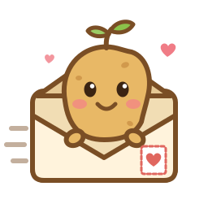

<p align="center"></p>

<h1 align="center">Mail-A-Patatina</h1>

A self-hosted, ad-free take on Tinybeans for [Immich](https://immich.app). Each morning, relatives get an email with the newest captioned photos from a shared Immich album. They tap ❤️ or comment without passwords, and every like and comment lands in Immich under their own name. The same moments can also go to WhatsApp, Signal or Telegram chats.

Mail-A-Patatina only **transports, presents and collects**. It has no database: everything it knows comes from, or is written back to, Immich.

```
             Immich = the single source of truth                 Mail-A-Patatina (stateless)
 ┌────────────────────────────────────────────────────────┐     ┌──────────────────────────────┐
 │ album "Family Feed"                                    │     │ daily email (your SMTP)      │
 │   photos + description (= caption)       ──────────────┼────►│ WhatsApp / Signal / Telegram │
 │   shared with Oma, Uncle Tom… (= recipients)           │     │ feed · calendar · photo page │
 │   ❤️ likes and comments, per person      ◄─────────────┼─────│ (magic links, no passwords)  │
 │   asset metadata "mail-a-patatina" (= what was sent)   │     └──────────────────────────────┘
 │   each person's email setting (= unsubscribe)          │
 └────────────────────────────────────────────────────────┘
```

| What | Where it lives |
|---|---|
| Photos, captions, dates | Immich assets and their description |
| What's shared | One album (photos with a description, if `REQUIRE_CAPTION=true`) |
| Who gets email | The people the album is shared with (not the owner, not the bot) |
| Likes and comments | Immich album activity, posted as each relative's own Immich account |
| What was already sent, and to whom | Immich asset metadata, key `mail-a-patatina` |
| Unsubscribed | The relative's own Immich *email notifications* setting |
| Families, chats, SMTP, schedule | Configuration: `.env` and `config/feeds.yml` or `config/chats.yml` |
| The relatives' API keys | Credentials: `./secrets/relatives.yml`, next to `.env` |

`./data` only holds a cache of resized JPEGs and is safe to delete. Restarting or rebuilding the container loses nothing.

## How it works

**Sharing a moment.** Add a photo to the album and write its description in Immich; both work in the mobile app. Writing the caption is what publishes it; uncaptioned photos are never sent. At `SEND_TIME` (default 07:00), everything new goes out. Until then, or for at least `SETTLE_MINUTES`, you can still fix the caption. To pull something back, remove it from the album or clear its caption. Each photo is sent only once, whatever is edited later, and photos already in the album when a family starts are never sent (unless `SEND_BACKLOG=true`).

**Relatives are Immich users.** Each relative gets a viewer-only Immich account that the album is shared with. When it's set up, `add-relative` creates an API key *for that account* that can only like, comment, take back its own like or comment, and read or change its email setting. It saves the key in `./secrets/relatives.yml`. Mail-A-Patatina uses that key to like and comment as the person, so their ❤️ and comments show up natively in your Immich app, and your replies in Immich appear on their page too. Relatives never need to know their account exists. This works on OAuth-only servers too: `add-relative` switches password login on for the few seconds it needs, because signing in once is the only way Immich lets anyone create a key for a user.

**Magic links.** Every link in the email signs the relative in, using an HMAC-signed token checked against the album's member list:
- Tapping ❤️ in the email likes the photo. Tapping it again on the page takes the like back, and relatives can delete their own comments.
- Tapping **Comment** opens the photo page, ready to type.
- The token is turned into a cookie and removed from the address bar right away.
- Removing someone from the album in Immich kills their link.
- Bumping `LINK_VERSION` kills all links at once.
- The ❤️ is only saved by an auto-submitted form on the page, so email security scanners that pre-open links can't like on someone's behalf.

**Group chats.** A link posted in a WhatsApp, Signal or Telegram group is shared by everyone in it:
- Visitors are asked for their name once. They comment through one bot account (`BOT_NAME`), shown in Immich as `[Tante Ute] Hi!` and on the page as *Tante Ute*.
- Immich allows one ❤️ per account, so a group has one shared ❤️.
- A one-to-one chat can instead be tied to a relative (`person:` in the chat's config), so its links sign in as them.

**Keeping photos on the server** (per family, on the setup page; `KEEP_PHOTOS_ON_SERVER`). Nothing is attached to emails or chat messages, so there's no photo file in anyone's mailbox or chat to forward or save:
- **Emails** load each photo from `PUBLIC_URL` through a link made for that one recipient. The link signs nobody in. It stops working after `PHOTO_LINK_DAYS` (default 30), and right away if the photo is removed from the album or loses its caption, or the recipient is removed.
- **Chats** get the caption and the link only. Telegram's link preview is switched off; the pages carry no preview image for WhatsApp or Signal to pick up.
- **What it doesn't prevent:** screenshots, saving the photo while it's displayed, or copies made by mail services that fetch images through their own proxy (Gmail does, and Apple Mail's privacy protection) while the link is valid. Some mail apps block remote images until the reader taps "load images"; the caption and buttons show either way. It makes photos much harder to pass around, not impossible.

**Only Immich's reactions.** Immich has exactly two kinds of activity: like (❤️) and comment. The site offers just those.

**What gets sent.** Each photo is marked in Immich when it's sent to each recipient and chat:
- Failed sends are retried at the next run.
- Someone newly added to the album catches up on the last `RESEND_HOURS` (default 48).
- When Mail-A-Patatina first starts on an album, photos already there count as backlog: they show on the website but aren't sent (`SEND_BACKLOG=true` sends them).
- `SEND_MODE=drip` sends one photo per day from the queue instead of a digest.

## Self-service setup

Everyone who can sign in to Immich can set up their own family feed at `PUBLIC_URL/setup/`, with no help from the admin:

1. **Sign in** with your identity provider (e.g. Pocket ID), the same account as for Immich.
2. **Connect Immich:** the page links to Immich's API-key screen and lists the eight permissions to tick. The pasted key is checked:
   - it must belong to the same email address,
   - it must have exactly what the feed needs,
   - it must not be able to administer Immich or delete anything, except take people out of the album (`albumUser.delete`).
3. **Album and rules:** pick one of your own albums, a title, the sending time and timezone, digest or one-a-day, whether only captioned photos go out, and whether you want an email when someone comments.
4. **People and chats:**
   - Add relatives by name and email.
   - Add co-parents by pasting a key they created in their own Immich account.
   - Remove a relative: takes them out of the album, since its members are who gets the emails. Their Immich account stays; the admin can delete it.
   - Remove a co-parent: Mail-A-Patatina forgets their key and stops sending their photos. Their access to the album in Immich isn't touched.
   - **WhatsApp:** link a WhatsApp account of the family's own, by scanning a QR code or typing a pairing code on the phone, like WhatsApp Web. Moments are posted from that account, and its groups are offered to pick from. Use a spare number rather than a personal one, because the server holds the session.
   - **Signal:** add the installation's number to the group and type the group's exact name. The page never lists the number's groups, because those include other families' groups.
   - **Telegram:** add the installation's bot and enter the group's chat id.
5. **Test email**, changing the rules, replacing the key, or deleting the feed, whenever you like.

**Relatives wait for the admin.** Creating an Immich account needs admin rights, and the running service doesn't hold any:
- **The admin is told:** a family's request shows up as "waiting for approval", and `INSTALL_ADMIN_EMAILS` gets an email.
- **One command approves:** the admin runs `approve`, which creates the accounts as before, with the `patatina-` prefix, no upload quota and their own narrow key.
- **Then they're live:** the relative appears as "ready" on the setup page and is in the next morning's email. The same goes for the group-chat account a feed needs once a chat is connected.
- **Relatives with an Immich account of their own** keep it untouched: no new account, no password reset. The album is shared with their account (right away from the setup page if Immich shows other users to non-admins, otherwise by `approve`). For emails and reactions they create a key in their account with the six relative permissions, and the family pastes it under *People → add key*. Removing them later only drops that key. (`add-relative --adopt` still takes an account over instead, if you really want that.)
- **Removed relatives keep their account** until the admin deletes it. When a family removes someone who is then in no family's album, `INSTALL_ADMIN_EMAILS` gets an email with the command. `forget` deletes the account only if no album at all is shared with it (it signs in as the person to check, so albums shared outside Mail-A-Patatina count too), and only accounts with the `patatina-` prefix. Immich purges it after its deletion delay, together with the person's old likes and comments. `pending` also lists such accounts.

```sh
docker compose run --rm -e IMMICH_ADMIN_API_KEY app python -m mail_a_patatina pending
docker compose run --rm -e IMMICH_ADMIN_API_KEY app python -m mail_a_patatina approve            # everything waiting
docker compose run --rm -e IMMICH_ADMIN_API_KEY app python -m mail_a_patatina --feed die-falks reject oma@example.com
docker compose run --rm -e IMMICH_ADMIN_API_KEY app python -m mail_a_patatina forget oma@example.com     # account no family needs
```

**Where the settings live:** each family's settings are saved as one file in `SETUP_DIR` (`./secrets/feeds/`, mode 600; it contains that family's key). Everything else stays in Immich, as before. People can only see and change the feeds they created themselves.

### Pocket ID (or any OIDC provider)

In Pocket ID, add an OIDC client:
- **Name:** `Mail-A-Patatina`
- **Callback URL:** `https://<your PUBLIC_URL>/setup/callback`
- **Optional:** under *allowed user groups*, limit it to the group that may use Immich.

Put its client id and secret into `OIDC_CLIENT_ID` and `OIDC_CLIENT_SECRET`, and Pocket ID's URL into `OIDC_ISSUER`. The login uses the authorization-code flow with PKCE and asks for `openid email profile`. The email address it returns is matched against the Immich account of the key a person pastes.

## Several families on one installation

One Mail-A-Patatina can serve several Immich users who don't know each other. Families usually set themselves up on the setup page (above); the admin can also define them in a file. Each family is a **feed**: one album, its owner's API key, its own title, send time, timezone, chats and bot account, listed in `config/feeds.yml` (see `feeds.example.yml`). With a single family you can skip that file and put `ALBUM_ID` and `IMMICH_API_KEY` in `.env`.

How families are kept apart:
- **Separate pages:** each family's pages live under `PUBLIC_URL/<feed id>/`, and the sign-in cookie only applies to that path.
- **Links can't cross over:** magic-link tokens are signed together with their feed id, so a link from the Müllers' email is rejected on the Schmidts' pages, even by someone who rewrites the URL.
- **Every request is checked against one album:** photos, likes and comments are only served if they belong to that feed's album, through that album owner's key.
- **Separate emails:** a grandma who is in two families' albums has one Immich account, gets two separate emails and has two separate links. Unsubscribing is her own Immich email setting, so it stops both.

Because the families' API keys sit in `config/feeds.yml`, whoever runs Mail-A-Patatina can read those families' libraries. In practice that's the Immich admin, who can see everything on the server anyway.

## Installation (admin)

The admin only sets up the installation; families do the rest on the setup page.

1. **Configure and start:**
   ```sh
   cp .env.example .env          # Immich URLs, SECRET_KEY, PUBLIC_URL, SMTP, OIDC client, INSTALL_ADMIN_EMAILS
   docker compose up -d          # pulls the image built by GitHub Actions (MAP_IMAGE), or add --build to build locally
   docker compose exec app python -m mail_a_patatina check
   ```
   Then register the OIDC client (see *Pocket ID* above) and send families the link `PUBLIC_URL/setup/`.
2. **Admin key for approvals** (`IMMICH_ADMIN_API_KEY`): `adminUser.read`, `adminUser.create`, `adminUser.update`, and `adminUser.delete` for `forget`.
   - **Pass it only to the commands that need it, never in `.env`:** `docker compose run --rm -e IMMICH_ADMIN_API_KEY app python -m mail_a_patatina approve`.
   - **OAuth-only Immich servers:** add `adminConfig.read` and `adminConfig.update`. Password login has to be on while an account gets its key, and `approve` switches it on for those few seconds and off again, even if something fails. Without those two permissions, or if your Immich settings come from a config file, it tells you to switch it yourself under *Administration → Settings → Authentication settings*.
   - **Delete rights, all narrow:** the relatives' `activity.delete` takes back their own like or comment; the album owner's `albumUser.delete` takes a relative out of the album; the admin key's `adminUser.delete` is only used by `forget`, on accounts Mail-A-Patatina created.
   - **What approved accounts look like:** they appear in Immich as `patatina-Oma Erika` (`USER_PREFIX`). Their storage quota is 0, so they can't upload anything, and their API key can't either. Immich's own album emails are switched off for them, so nobody gets two.
3. **Reverse proxy:** expose only port 8080, with HTTPS (Caddy, Traefik, nginx…), and set `PUBLIC_URL` to that address. Immich itself never has to be reachable from the internet, because images and videos are proxied.
4. **Email delivery:** make sure the sending domain has SPF, DKIM and DMARC set up, or the morning email lands in spam.

**Co-parents who add their own photos:** Immich only lets a photo's owner write its metadata, where Mail-A-Patatina records what was sent. So the co-parent creates a key in *their own* account with exactly `user.read`, `asset.read` and `asset.update` and gives it to the parent who set up the feed. That parent pastes it under *Co-parents* on the setup page; the co-parent never signs in there. The key must belong to someone the album is shared with. Until a key is added, their photos are skipped, and the setup page says whose. For families in `feeds.yml`, the admin lists the keys under `contributor_keys`.

**Families defined by the admin** instead of on the setup page also still work: `config/feeds.yml`, or `ALBUM_ID` in `.env` for a single family, with `add-relative` and `add-bot` on the CLI. `add-relative --adopt` takes over an existing Immich account, which resets its password, so don't adopt anyone who signs in to Immich themselves.

### Messenger gateways (admin)

Families connect their own groups on the setup page. The admin runs the gateways.

#### WhatsApp (GOWA)

Every family sends from a WhatsApp account under its own control. The installation has no WhatsApp number.

1. Set `WHATSAPP_AUTH` in `.env`, then start the gateway with `docker compose --profile whatsapp up -d`.
2. That's all for the admin. Families link their accounts on the setup page, and GOWA keeps one session ("device") per family, named after the feed. Unlinking or deleting the feed removes the session.
3. **Families defined in `.env` or `feeds.yml`** link with `docker compose run --rm app python -m mail_a_patatina whatsapp-link --feed <id> +491701234567`, which prints a code to type in on that phone. `whatsapp-groups --feed <id>` then lists the chat ids of its groups.

⚠️ WhatsApp has no official API for posting to groups. GOWA acts like WhatsApp Web on a linked phone, which is against WhatsApp's terms and can get the number banned. Tell families to use a spare number, not their personal one. The server can also read that account's chats. Keep the volume to these few messages a day.

#### Signal and Telegram

- **Signal:** run `docker compose --profile signal up -d`, then link via `http://127.0.0.1:8081/v1/qrcodelink?device_name=family-feed`. Set `SIGNAL_NUMBER`. Group ids are at `/v1/groups/<number>`.
- **Telegram:** create a bot with @BotFather, add it to the group, and set `TELEGRAM_BOT_TOKEN`. Use the group's (negative) chat id.

## Container image

`.github/workflows/container.yml` builds the image for amd64 and arm64 and pushes it to the GitHub Container Registry:
- **Pushes to `main`** become `ghcr.io/<owner>/<repo>:latest`.
- **Tags like `v1.2.0`** become `:1.2.0` and `:1.2`.
- **Every build** also gets a `:sha-…` tag.
- **Pull requests** are built but not pushed.

Point `MAP_IMAGE` in `.env` at your image. If the package is private, run `docker login ghcr.io` on the server first.

Running from a checkout without Docker works too: `pip install -r requirements.txt`, then `uvicorn mail_a_patatina.web:app` from the repo root. It reads `.env` and `feeds.yml` from the current folder.

## Logo

The patatina lives in `assets/`:
- **`logo.svg`, `logo.png`:** the logo for the repo and anywhere else.
- **`social-preview.png`:** the card shown when the repo is shared. Upload it under *Settings → General → Social preview* on GitHub; the preview can't be set from a file in the repo.

The app uses its own copies in `mail_a_patatina/static/`:
- `favicon.svg` and `apple-touch-icon.png` for the browser tab and home screen,
- `logo-email.png`, embedded in every email, because most mail apps don't show SVG.

## Admin commands

`--feed <id>` picks the family; it can be left out when there is only one. `check`, `links`, `sync` and `dispatch` cover all families when no feed is named.

```sh
docker compose exec app python -m mail_a_patatina check                              # setup status, who gets what
docker compose run --rm -e IMMICH_ADMIN_API_KEY app python -m mail_a_patatina pending   # what families are waiting for
docker compose run --rm -e IMMICH_ADMIN_API_KEY app python -m mail_a_patatina approve [EMAIL]
docker compose run --rm -e IMMICH_ADMIN_API_KEY app python -m mail_a_patatina --feed die-falks reject EMAIL
docker compose exec app python -m mail_a_patatina links                              # everyone's magic links
docker compose exec app python -m mail_a_patatina --feed mueller send-test EMAIL -n 3   # doesn't mark anything as sent
docker compose exec app python -m mail_a_patatina sync | dispatch
docker compose run --rm -e IMMICH_ADMIN_API_KEY app python -m mail_a_patatina --feed mueller add-relative NAME EMAIL [--adopt]
docker compose run --rm -e IMMICH_ADMIN_API_KEY app python -m mail_a_patatina --feed mueller add-bot
```

## Keep in mind

- **Back up `./secrets` like `.env`.** If the keys are lost, run `add-relative` again for each relative, with password login switched on for a moment. You can see and revoke each key in Immich under the relative's account (*API keys → Mail-A-Patatina*).
- **`SECRET_KEY`:** it signs the magic links. It also derives the relatives' passwords, which are only used while `add-relative` runs. If you change it, `add-relative` needs `--adopt` for existing relatives.
- **Immich's own emails:** if Immich's own SMTP is set up, it may still email album *invites*. `add-relative` turns off album update emails for managed accounts, and invites aren't sent because accounts are created with `notify: false`.
- **Removing a relative:** remove them from the album (their link stops working). Delete the Immich account if you like; their likes and comments go with it.
